<p align="center">
  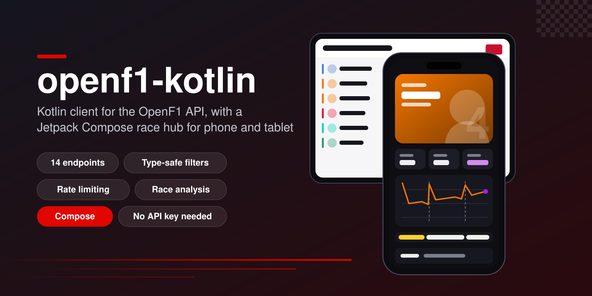
</p>

<p align="center">
  <a href="https://github.com/halilozel1903/openf1-kotlin/actions/workflows/ci.yml"></a>
  <a href="https://jitpack.io/#halilozel1903/openf1-kotlin"></a>
  
  
  
  
  
  <a href="LICENSE"></a>
</p>

**openf1-kotlin** is a Kotlin client for [OpenF1](https://openf1.org), the free API for Formula 1 timing, telemetry and session data from 2023 on. Every endpoint has typed models and a block of **type-safe filters** with the comparison operators OpenF1 supports, so `lapNumber lte 10` or `date gte instant` compiles only on endpoints that have those attributes. The client spaces requests to OpenF1's rate limit, retries after HTTP 429, caches finished-session data, and comes with race analysis helpers: a classification built from position data, fastest laps, representative race pace, stints and pit stops by driver, and weather summaries. The core is pure Kotlin/JVM (Ktor and kotlinx.serialization), so it runs on Android, on the server and in tests. The sample app is a Jetpack Compose race hub for phones and tablets.

```kotlin
val client = OpenF1Client()

// Find a finished race through the API, then query it.
val race = client.sessions {
    year eq 2025
    sessionName eq "Race"
    location eq "Yas Island"
}.single()

val classification = client.positions { sessionKey eq race.sessionKey }.classification()
val quickLaps = client.laps {
    sessionKey eq race.sessionKey
    driverNumber oneOf listOf(1, 4, 81)
    lapNumber inRange 40..58
    lapDuration lt 87.0
}
val drivers = client.completeHeadshots(client.drivers { sessionKey eq race.sessionKey })
```

## Screenshots

Captured live from the OpenF1 API by CI, with the sample app on Android emulators. The race is the 2025 Abu Dhabi Grand Prix, which the app looks up through the sessions endpoint during the run. Results, lap times, tyre stints, pit stops and weather are real OpenF1 data, and the headshots and flags are the images OpenF1 links to on formula1.com.

| Season | Classification | Driver grid | Driver race |
| :---: | :---: | :---: | :---: |
| 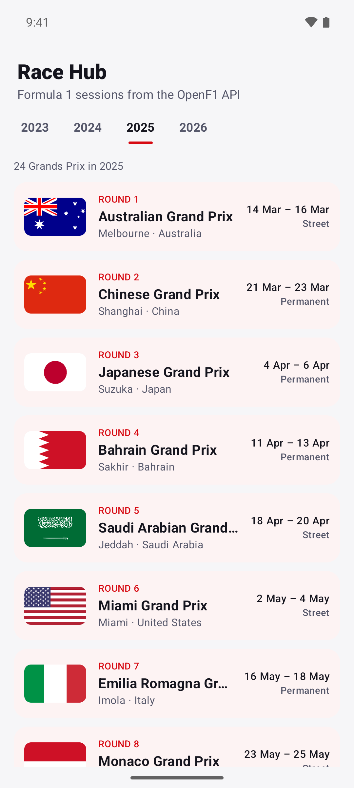 | 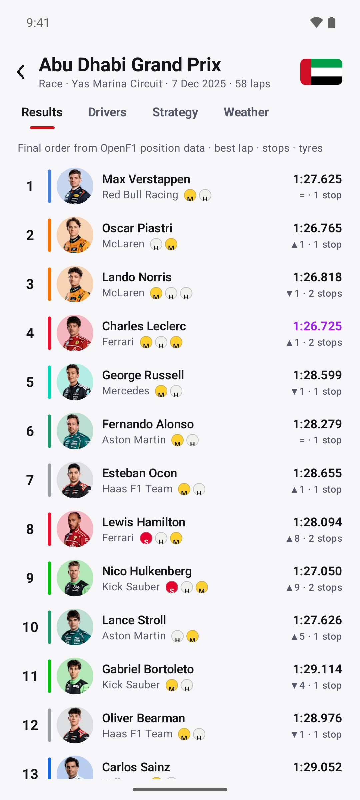 | 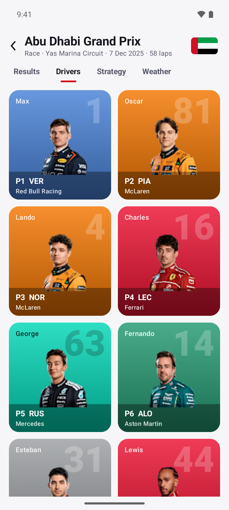 | 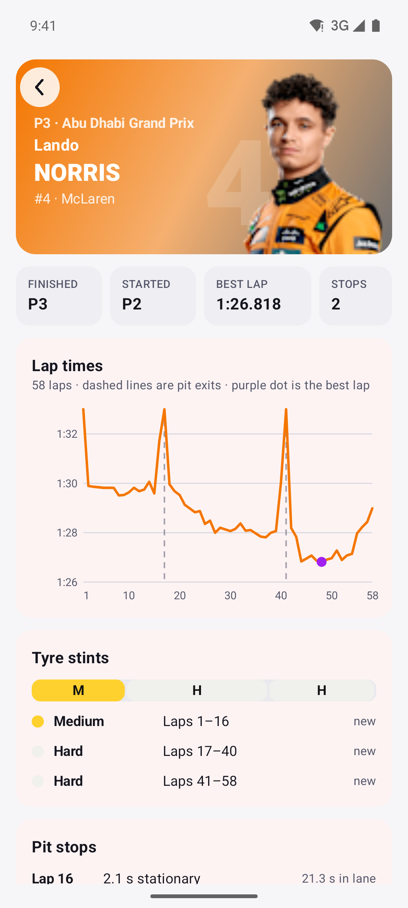 |

**Tablet:** the classification and the selected driver's race side by side.

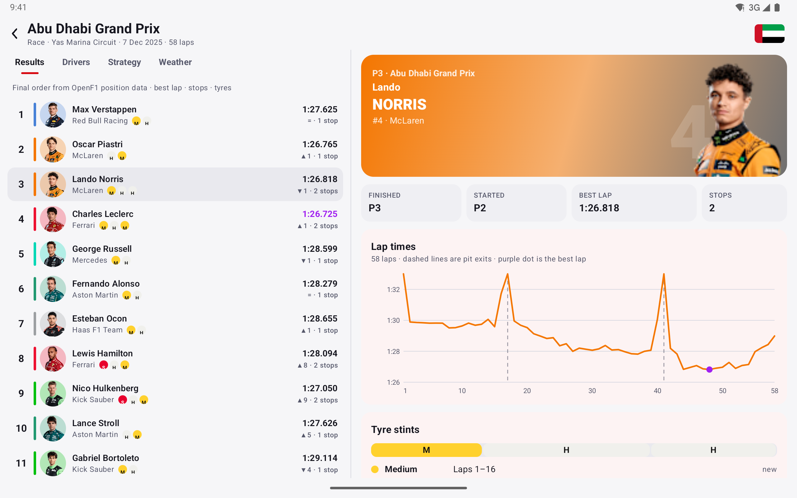

| Season, dark | Classification, dark | Driver grid, dark | Driver race, dark |
| :---: | :---: | :---: | :---: |
| 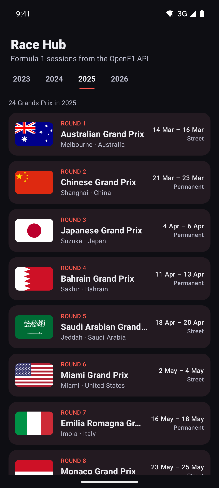 | 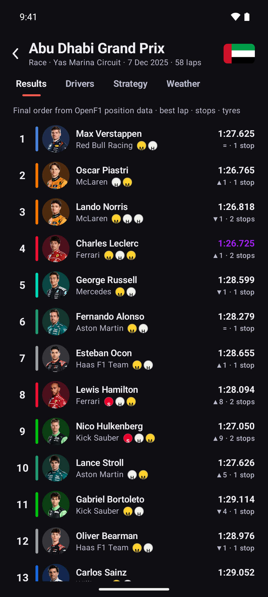 | 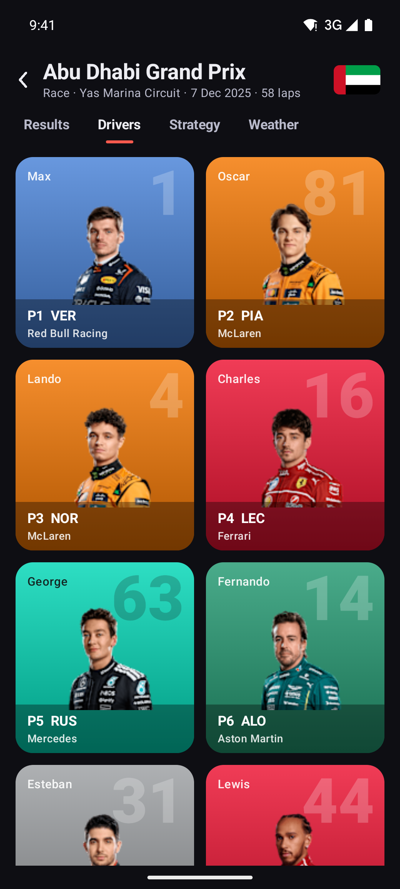 | 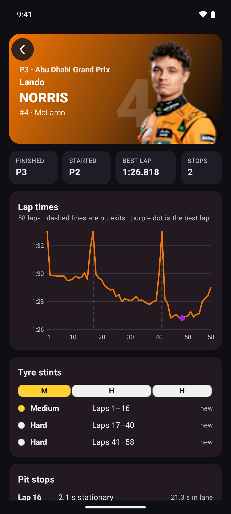 |

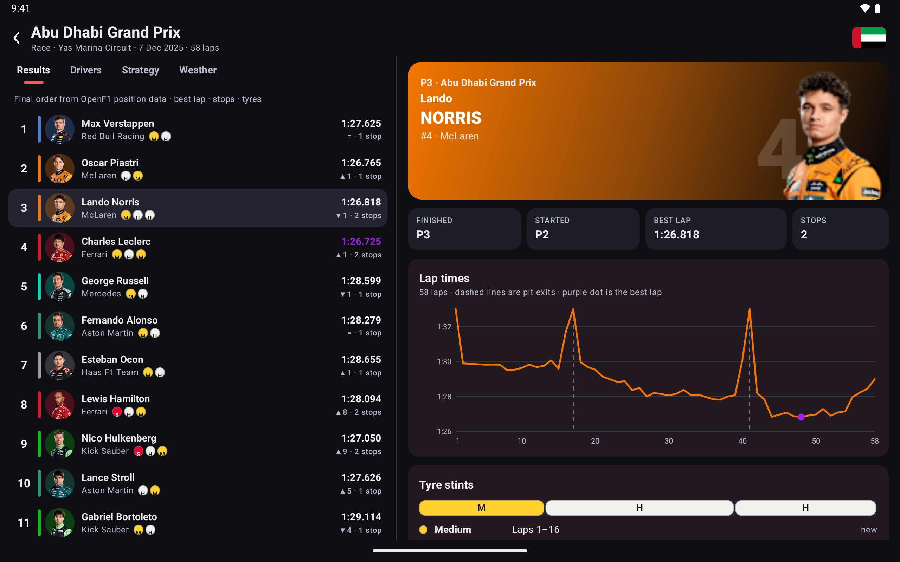

## Features

- **Every endpoint**: meetings, sessions, drivers, laps, position, intervals, pit, stints, race control, weather, car data, team radio, session results and starting grid, as `suspend` functions returning typed models.
- **Type-safe query filters**: each endpoint's block offers only its own attributes, typed as numbers, text, booleans or dates, with `eq`, `gt`, `gte`, `lt`, `lte`, `between`, `inRange` and `oneOf`. Dates take a `kotlin.time.Instant` or any text OpenF1 accepts. `meetingKey.latest()` and `sessionKey.latest()` target the current session, and `raw()` covers attributes the library does not model yet.
- **Correct encoding**: operators are sent the way browsers send them (`lap_number%3C=3`), values are percent-encoded (`+00:00` offsets, spaces, accents), and repeated filters match any of the values.
- **Robust models**: everything OpenF1 can leave out is nullable; gaps read both `41.019` and `"+1 LAP"` into a `Gap`; qualifying results read `duration` and `gap_to_leader` arrays (Q1, Q2, Q3) and race results their single value into the same list; unknown attributes are ignored.
- **No results is an empty list**: OpenF1 answers 404 when nothing matches; you get `emptyList()`.
- **Rate limiting**: requests wait for their turn within OpenF1's free tier (3 a second, 30 a minute) or the sponsor tier, and HTTP 429 is retried after `Retry-After`.
- **Caching**: an in-memory cache keyed by url, since finished sessions never change. `latest` queries are never cached.
- **Live data**: set a sponsor `accessToken` (or a `tokenProvider` that refreshes it) and it is sent as a bearer token. Historical data needs no key.
- **Race analysis**: `classification()` from position changes (with start positions and places gained), `fastestLap()`, `fastestLapByDriver()`, `representativeLaps()` for race pace, `byDriver()` for stints and pit stops, `fastestStop()`, weather `summary()`, `LapTimes.format(88.987)` → `1:28.987`.
- **Headshots that are there**: `completeHeadshots()` fills missing `headshot_url`s (OpenF1 leaves them out for some drivers in some sessions) from the same driver's other sessions, in one request.
- **CSV**: `csv(endpoint, filters)` returns OpenF1's CSV output for spreadsheets and notebooks.
- **Testable**: swap HTTP for a `FixtureTransport` or a Ktor `MockEngine`.

### API coverage

| Endpoint | Function | Model | Notable filters |
| --- | --- | --- | --- |
| `/meetings` | `meetings { }` | `Meeting` | `year`, `meetingKey`, `countryName`, `circuitShortName`, `dateStart` |
| `/sessions` | `sessions { }` | `Session` | `year`, `sessionName`, `sessionType`, `location`, `dateEnd` |
| `/drivers` | `drivers { }` | `Driver` | `sessionKey`, `driverNumber`, `nameAcronym`, `teamName` |
| `/laps` | `laps { }` | `Lap` | `lapNumber`, `lapDuration`, `isPitOutLap`, `stSpeed`, `dateStart` |
| `/position` | `positions { }` | `Position` | `position`, `date` |
| `/intervals` | `intervals { }` | `Interval` | `gapToLeader`, `interval`, `date` |
| `/pit` | `pitStops { }` | `PitStop` | `lapNumber`, `laneDuration`, `stopDuration` |
| `/stints` | `stints { }` | `Stint` | `compound`, `stintNumber`, `lapStart`, `tyreAgeAtStart` |
| `/race_control` | `raceControl { }` | `RaceControlMessage` | `category`, `flag`, `scope`, `lapNumber` |
| `/weather` | `weather { }` | `Weather` | `trackTemperature`, `rainfall`, `windSpeed`, `date` |
| `/car_data` | `carData { }` | `CarData` | `speed`, `rpm`, `nGear`, `throttle`, `drs`, `date` |
| `/team_radio` | `teamRadio { }` | `TeamRadio` | `driverNumber`, `date` |
| `/session_result` | `sessionResults { }` | `SessionResult` | `position`, `dnf`, `dns`, `dsq` |
| `/starting_grid` | `startingGrid { }` | `StartingGridSlot` | `position`, `lapDuration` |

Every endpoint that belongs to a session also has `meetingKey` and `sessionKey`, and every per-driver endpoint `driverNumber`.

## Installation

Add JitPack to `settings.gradle.kts`:

```kotlin
dependencyResolutionManagement {
    repositories {
        google()
        mavenCentral()
        maven("https://jitpack.io")
    }
}
```

Then the dependency:

```kotlin
dependencies {
    implementation("com.github.halilozel1903.openf1-kotlin:openf1:1.0.0")

    // Optional: use OkHttp instead of Ktor's CIO engine.
    implementation("io.ktor:ktor-client-okhttp:3.6.0")
}
```

> The build is also set up for Maven Central (`io.github.halilozel1903:openf1`) via the vanniktech publish plugin.

`openf1` is a plain Kotlin/JVM library (JDK 17+), so it also works in server and desktop projects.

## Usage

**Create a client**

```kotlin
val client = OpenF1Client()                     // CIO engine, free-tier rate limit, memory cache

val tuned = OpenF1Client {
    engine = OkHttp.create()                    // share your app's OkHttp
    rateLimit = RateLimit.Sponsor               // or null to turn it off
    cache = OpenF1Cache.memory(maxEntries = 128)
    accessToken = sponsorToken                  // only for sessions that are running
    requestTimeoutMillis = 60_000
}
```

Close the client with `client.close()` when you are done with it.

**Filters and operators**

```kotlin
// Laps 10 to 20 of two drivers that were quicker than 1:30.
client.laps {
    sessionKey eq 9839
    driverNumber.oneOf(4, 81)
    lapNumber inRange 10..20
    lapDuration lt 90.0
}

// Positions in the last half hour of a race, by time.
client.positions {
    sessionKey eq 9839
    date.between(Instant.parse("2025-12-07T14:30:00Z"), Instant.parse("2025-12-07T15:00:00Z"))
}

// Telemetry: always narrow car data to a driver and a short window.
client.carData {
    sessionKey eq 9839
    driverNumber eq 4
    date gte "2025-12-07T14:13:00"
    date lt "2025-12-07T14:14:30"
    speed gte 315
}

// The current session (live data needs a sponsor token).
client.sessions { sessionKey.latest() }
```

Each block is a separate query class (`LapsQuery`, `PositionQuery`, ...), so `client.laps { compound eq "SOFT" }` does not compile: `compound` belongs to `/stints`. To see the url a query produces, use `client.urlFor(OpenF1Endpoint.Laps, LapsQuery().apply { lapNumber lte 3 })`, which gives `https://api.openf1.org/v1/laps?lap_number%3C=3`.

**A race at a glance**

```kotlin
val session = client.latestCompletedSession(sessionName = "Race")!!   // or look one up by year and location
val key = session.sessionKey

val drivers = client.completeHeadshots(client.drivers { sessionKey eq key }).associateBy { it.driverNumber }
val order = client.positions { sessionKey eq key }.classification()
val laps = client.laps { sessionKey eq key }
val stints = client.stints { sessionKey eq key }.byDriver()
val stops = client.pitStops { sessionKey eq key }

order.forEach { row ->
    val driver = drivers[row.driverNumber]
    println("P${row.position} ${driver?.nameAcronym} (started P${row.startPosition}) ${stints[row.driverNumber]?.map { it.tyre.letter }}")
}
laps.fastestLap()?.let { println("Fastest lap: ${LapTimes.format(it.lapDuration!!)} by #${it.driverNumber}") }
stops.fastestStop()?.let { println("Fastest stop: ${it.stopDuration} s") }
client.weather { sessionKey eq key }.summary().trackTemperature   // lowest..highest, °C
```

`classification()` uses position changes, the data OpenF1 records during the session. For the official result with post-race penalties, use `client.sessionResults { sessionKey eq key }`.

**Gaps and results**

```kotlin
client.intervals { sessionKey eq key; driverNumber eq 44 }.last().gapToLeader
// Gap.Seconds(seconds) or Gap.Laps(laps), null for the leader

client.sessionResults { sessionKey eq qualifyingKey }.first().duration
// one best lap per part, Q1, Q2 and Q3; null for parts the driver did not reach
```

**Team colours and tyres**

```kotlin
driver.teamColorArgb        // 0xFFF47600 from "F47600", ready for Color(it) in Compose
stint.tyre                  // TyreCompound.Hard, with letter "H" and the sidewall colour
```

**Errors**

Every function throws an `OpenF1Exception`: `Unauthorized` (401 or 403, a live session without a sponsor token), `RateLimited` (429 after the configured retries), `Http` (with the status and body, such as 422 for a query that matches too much data), `Network` or `Decoding`.

**Testing**

```kotlin
val client = OpenF1Client {
    transport = FixtureTransport { endpoint, query -> javaClass.getResource("/fixtures/$endpoint.json")?.readText() }
    rateLimit = null
}
```

## Sample app

The `sample` module is a race hub. It opens on a season's Grands Prix with flags (2023 to 2026); a race shows tabs for the **classification** built from position data (team colour bars, headshots, best laps with the fastest in purple, places gained, stops and tyres), a **driver grid** of team colour cards with headshots, the **strategy** of the whole field as tyre strips with the quickest pit stops, and the **weather** with a temperature chart. A driver opens their race: result tiles, a **lap time chart** with pit laps marked, **tyre stints** and **pit stops**. On tablets the race and the selected driver sit side by side. It uses the live API through one client with the free-tier rate limit, OkHttp as the Ktor engine and Coil for images.

For screenshots it opens a fixed screen from an intent extra (used by `scripts/screenshots.sh`):

```bash
./gradlew :sample:installDebug
adb shell am start -n io.github.halilozel1903.openf1.sample/.MainActivity --es scene driver
```

`scene` is one of `meetings` (the 2025 season), `race` (the classification), `drivers` (the driver grid), `driver` (Lando Norris's race) or `tablet` (classification and driver side by side). The race scenes look up the 2025 Abu Dhabi Grand Prix through `/sessions` at runtime and load it live like a normal launch, then log `SCENE_READY` once the data and every headshot and flag on screen have loaded. CI captures the phone scenes on a Pixel 7 and `tablet` on a Pixel Tablet in landscape, in light and dark mode, and fails instead of capturing when a scene shows an error, does not finish loading, misses the expected text or is blank.

## Be nice to OpenF1

OpenF1 is free and community run. The free tier allows 3 requests a second and 30 a minute; this client stays within that by default. Prefer one request for a whole session (all laps, all positions) over one per driver or lap, keep the cache on, and narrow `car_data` to a driver and a short time window. If you use it a lot, consider [sponsoring the project](https://openf1.org).

## Project structure

| Module | What it is |
| --- | --- |
| `openf1` | Pure Kotlin/JVM: `OpenF1Client`, query DSL, models, rate limiter, cache, analysis helpers, `FixtureTransport`. Published as `openf1` |
| `sample` | The Compose race hub for phones and tablets, with screenshot scenes |

## Tech stack

Kotlin 2.4 · Ktor 3.6 (CIO, OkHttp) · kotlinx.serialization · kotlinx.coroutines · AGP 9.4 with built-in Kotlin · Gradle 9.6 · Jetpack Compose (BOM 2026.09) · Material 3 · Coil 3 (sample) · GitHub Actions with Android emulators

## Legal

This project is unofficial and is not associated with Formula 1, the FIA or any team. F1, FORMULA ONE, FORMULA 1, FIA FORMULA ONE WORLD CHAMPIONSHIP, GRAND PRIX and related marks are trademarks of Formula One Licensing B.V. Data comes from [OpenF1](https://openf1.org), which is also unofficial. Headshot and flag urls in that data point to formula1.com; the screenshots show those images as loaded during the CI run, and this repository does not otherwise include them.

## License

MIT. See [LICENSE](LICENSE).
